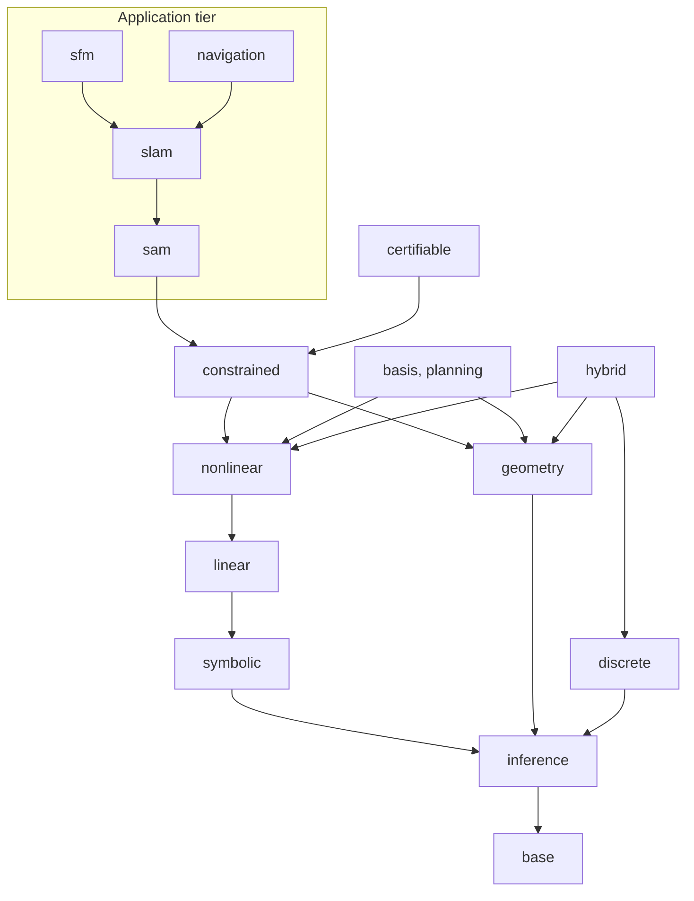

# GTSAM architecture

GTSAM represents estimation and optimization problems using factor graphs.
Variables have keys and values, factors define local relationships and costs,
and inference and optimization algorithms exploit the graph structure. New
functionality should build on these abstractions so mathematical models,
numerical algorithms, and execution backends can evolve independently.

## Module map

| Module | Responsibility and entry points |
| --- | --- |
| [base](gtsam/base) | Mathematical building blocks: `traits<T>`, `Manifold`, `LieGroup`, `VectorSpace`, `OptionalJacobian`, matrix utilities, numerical derivatives, and scheduling. |
| [geometry](gtsam/geometry) | Manifold-valued states and geometric operations: `Pose2`, `Pose3`, `Rot3`, `Unit3`, `Gal3`, cameras, and triangulation. |
| [basis](gtsam/basis) | Function approximation, splines, and trajectory bases: `Basis`, `FitBasis`, and `CumulativeSplineTrajectory`. |
| [inference](gtsam/inference) | Graph structure independent of numerical representation: `Key`, `Symbol`, `FactorGraph`, `Ordering`, `VariableIndex`, elimination trees, Bayes nets, and Bayes trees. |
| [symbolic](gtsam/symbolic) | Structural elimination without numeric factor entries: `SymbolicFactorGraph` and symbolic Bayes nets and trees. |
| [linear](gtsam/linear) | Gaussian inference and least squares: noise models, `JacobianFactor`, `HessianFactor`, `GaussianFactorGraph`, `VectorValues`, and linear solvers. |
| [nonlinear](gtsam/nonlinear) | Manifold-valued nonlinear inference: `Values`, `NonlinearFactorGraph`, `NoiseModelFactorN`, `ExpressionFactor`, batch optimizers, iSAM2, marginals, fixed-lag smoothing, and continuous-time GP factors. |
| [discrete](gtsam/discrete) | Discrete factors, decision trees, tables, discrete elimination, and search. |
| [hybrid](gtsam/hybrid) | Joint discrete-continuous inference: `HybridFactorGraph`, `HybridGaussianFactorGraph`, `HybridValues`, and hybrid smoothers. |
| [constrained](gtsam/constrained) | Linear and nonlinear constraints, QP/QCQP problem representations, active-set and augmented-Lagrangian solvers. |
| [certifiable](gtsam/certifiable) | Lifted semidefinite problems and the Riemannian staircase optimizer. |
| [sam](gtsam/sam) | General measurement factors such as bearing, range, and bearing-range, and RISAM. |
| [slam](gtsam/slam) | SLAM-specific factors, smart projection factors, pose-graph initialization, synchronization, and dataset I/O. |
| [sfm](gtsam/sfm) | Structure-from-motion algorithms, global positioning, rotation and translation recovery, and specialized bundle adjustment. |
| [navigation](gtsam/navigation) | Navigation states, IMU preintegration, navigation measurement factors, geometric filters, and scenarios. |
| [planning](gtsam/planning) | Sampling-based trajectory optimization: `SamplingPlanner`, `MPPI`, `CEM`, `PredictiveSampling`, `GaussianProposal`, and `TrajectoryCosts`. |

The [CMake module list](gtsam/CMakeLists.txt) defines the stable library.
These modules share one C++ library. The table describes conceptual
responsibilities rather than independent compilation targets.

## Include direction between modules

Library code can include headers from its own module and any module reachable
by following the dependencies in this table. For example,
`nonlinear` can include `linear`, `symbolic`, `inference`, and `base`
directly. `hybrid` can use both the discrete and nonlinear stacks.

Arrows point from an including module to its immediate dependencies. SfM,
SAM, SLAM, and navigation form the application tier, with arrows showing
their dependencies within that tier.



| Including module | Immediate dependencies |
| --- | --- |
| `base` | None |
| `inference` | `base` |
| `geometry`, `symbolic`, `discrete` | `inference` |
| `linear` | `symbolic` |
| `nonlinear` | `linear` |
| `basis`, `constrained`, `planning` | `geometry`, `nonlinear` |
| `hybrid` | `discrete`, `geometry`, `nonlinear` |
| `certifiable`, `sam` | `constrained` |
| `slam` | `sam` |
| `sfm`, `navigation` | `slam` |

The graph captures GTSAM's intended layering. For example, camera sets use
inference keys, range factors can construct constrained problems, and navigation
factors can reuse SLAM's `BetweenFactor`. When a lower module needs behavior from
a higher one, put the integration in the higher module or extract the shared
operation into a lower module that both can use.

Several existing includes cross this boundary. Compatibility headers in `base`,
`nonlinear`, and `slam` forward to relocated implementations. Other exceptions
include inference's indexed symbolic elimination, geometry's optimized
triangulation and Karcher means, and `HybridValues` overloads in discrete,
linear, and nonlinear factors. The [checker](scripts/check_code_quality.py)
records each existing exception by including file and included header. The
module rule covers stable library C/C++ and CUDA sources. Tests, examples,
benchmarks, documentation, and wrapper glue can compose modules freely within
the other stable/experimental boundaries described below.

Nonlinear factors should use manifold traits for operations on their value
types. The generic WNOA graph and interpolator live in `nonlinear`. Their
explicit instantiations live in `sam`, which can include both the templates
and the concrete geometry types. The pose-aware Graphviz layout also lives
in `sam`. It supplies the existing `NonlinearFactorGraph::dot` and `saveGraph`
overloads that take `Values`.

Generic graph visualization can supply coordinates by key through
`DotWriter::variablePositions`. The graph topology is rendered through the
`FactorGraph` interface.

```cpp
gtsam::DotWriter writer;
writer.variablePositions.emplace(key, gtsam::Vector2{1.0, 2.0});
const gtsam::NonlinearFactorGraph::Base& topology = graph;
const auto dot = topology.dot(gtsam::DefaultKeyFormatter, writer);
```

## Estimation and optimization

The usual estimation path is:

1. Represent states using existing geometry types or implement the relevant
   [manifold traits](gtsam/base/Manifold.h) for a new type.
2. Store states in [Values](gtsam/nonlinear/Values.h) and models in a
   [NonlinearFactorGraph](gtsam/nonlinear/NonlinearFactorGraph.h). Use
   [NoiseModelFactorN](gtsam/nonlinear/NoiseModelFactorN.h) for typed residuals
   or [ExpressionFactor](gtsam/nonlinear/ExpressionFactor.h) for composed
   expressions. Reuse [noise models](gtsam/linear/NoiseModel.h) for whitening,
   robust losses, and constrained residuals.
3. Linearize the graph into a [GaussianFactorGraph](gtsam/linear/GaussianFactorGraph.h)
   containing Jacobian or Hessian factors. The linear layer solves for
   increments represented by [VectorValues](gtsam/linear/VectorValues.h).
4. Use a [nonlinear optimizer](gtsam/nonlinear/NonlinearOptimizer.h) to manage
   iterations, retraction, and termination. Use [ISAM2](gtsam/nonlinear/ISAM2.h)
   for incremental inference and [FixedLagSmoother](gtsam/nonlinear/FixedLagSmoother.h)
   for bounded-history estimation.

Graph ordering and elimination structures belong in the inference layer.
Numerical factor storage and linear solves belong in the linear layer.
Reusable nonlinear optimization policies belong in the nonlinear layer.
Application factors should express their measurements and costs through those
interfaces.

## Execution backends

### CPU

Use the existing Gaussian graph operations and linear solver infrastructure
when implementing another optimizer. Relevant entry points include
[MultifrontalSolver](gtsam/linear/MultifrontalSolver.h),
[IterativeSolver](gtsam/linear/IterativeSolver.h), and
[NonlinearMultifrontalSolver](gtsam/nonlinear/NonlinearMultifrontalSolver.h).
[PriorityScheduler](gtsam/base/PriorityScheduler.h) and
[TaskScheduler](gtsam/base/TaskScheduler.h) provide shared task scheduling.

### CUDA

CUDA support is organized within the owning modules. Device allocation and
context utilities live in [base/cuda](gtsam/base/cuda).
[linear/cuda](gtsam/linear/cuda) provides reusable linear systems, sparse
device storage, and a [linear solver session](gtsam/linear/cuda/LinearSolver.h).
[nonlinear/cuda](gtsam/nonlinear/cuda) implements generic sparse nonlinear
optimization through
[SparseLevenbergMarquardtOptimizer](gtsam/nonlinear/cuda/SparseLevenbergMarquardt.h).
[sfm/cuda](gtsam/sfm/cuda) implements specialized bundle adjustment.

When accelerating a new class of problems, inspect these existing layers
first. Keep graph interpretation and problem-specific linearization in their
owning modules. Reuse the shared device utilities and linear solver sessions
where they support the required representation. Preserve the mathematical
semantics and configuration of the corresponding CPU functionality.

## Choosing an extension point

| Contribution | Existing abstraction to examine first |
| --- | --- |
| New measurement | `NoiseModelFactorN`, `ExpressionFactor`, and existing factors in the relevant domain module |
| New state or Lie group | `traits<T>`, `Manifold`, `LieGroup`, and existing geometry types |
| New nonlinear optimizer | `NonlinearOptimizer`, `NonlinearOptimizerParams`, `NonlinearFactorGraph`, and existing optimizer implementations |
| New linear solver | `GaussianFactorGraph`, `Ordering`, and relevant existing solver interfaces |
| New continuous-time factor | `WnoaFactorGraph`, `WnoaMotionFactor`, `WnoaInterpFactor`, and `WnoaInterpolator` |
| New sampling-based planner | `SamplingPlanner`, [sampling algorithms](gtsam/planning/SamplingAlgorithms.h), [control proposals](gtsam/planning/ControlProposals.h), and [candidate scoring](gtsam/planning/CandidateScoring.h) |
| New constrained optimization method | `ConstrainedOptProblem`, `QpProblem`, `NonlinearConstraint`, and existing solvers |
| New GPU backend | `gtsam::cuda::LinearSolverSession` and the existing CUDA frontends |

Identify the relevant existing implementations before introducing an API.
When a contribution needs an operation already implemented for a closely
related problem, consider extending the existing abstraction. Keep reusable
algorithms in the library and use examples to demonstrate their use.

## Stable, experimental, and language boundaries

- Stable C++ library code under `gtsam/` must be independent of
  [gtsam_unstable](gtsam_unstable). Experimental code can depend on the stable
  library. Promotions should move the implementation and update its includes,
  tests, exports, wrappers, and documentation.
- Public out-of-line symbols use the export macro of their owning library.
  See [export guidelines](Using-GTSAM-EXPORT.md).
- Python and MATLAB expose the C++ APIs through shared module `.i` files.
  The top-level [wrap](wrap) subtree contains the upstream generator.
  See [developer guidance](DEVELOP.md) and
  [repository guidance](.github/copilot-instructions.md) for wrapper placement
  and compatibility.
- Tests live alongside modules under `tests/`. Use
  [numericalDerivative.h](gtsam/base/numericalDerivative.h),
  [chartTesting.h](gtsam/base/chartTesting.h), and
  [factorTesting.h](gtsam/nonlinear/factorTesting.h) where applicable.

## Automated quality checks

Run `python3 scripts/check_code_quality.py` from the repository root to check
module include direction, stable-to-unstable includes, export macro ownership,
and the deprecated exception spelling. CI runs the same checks. The script
scans tracked C++ and wrapper sources, excludes vendored dependencies, and
documents existing exceptions.

The [developer guide](DEVELOP.md) and
[repository guidance](.github/copilot-instructions.md) describe coding
conventions, tests, and review requirements.
