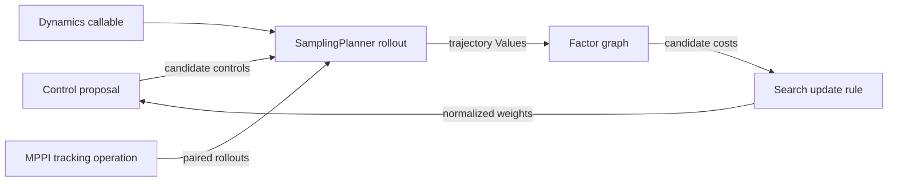

# Sampling-based planning with factor-graph costs

By Akash Ratheesh and Frank Dellaert

A sampling planner chooses a sequence of controls by predicting what each candidate
would do and scoring the resulting trajectory. In GTSAM the dynamics describe
how the state evolves, and a `NonlinearFactorGraph` describes what makes a
trajectory desirable. A terminal pose prior can express a goal, a control prior
can penalize effort, and a factor joining distant states can score net displacement.

## How a solve fits together



The planner owns the horizon, rollout, and graph evaluation. The proposal owns
the sampling distribution and knows how to adjust its nominal control sequence.
The update rule converts candidate costs to weights. A proposal can also supply a
likelihood correction for MPPI. This division lets the same optimization code plan for a point mass
or a robot on a manifold, and lets the caller change an objective by editing factors.

| C++ API | Role |
| --- | --- |
| `SamplingPlanner<State, Control>(stateKeys, controlKeys, dt)` | Associates the trajectory with its ordered graph keys and sets the integration step for a vector field. |
| `GaussianProposal(covariance, numSamples, seed)` | Uses `GaussianNoiseSampler` to perturb the current control sequence and updates it with a weighted mean. |
| `MPPI(inverseTemperature)` | Converts the graph costs into normalized weights and passes them back to the proposal. |
| `CEM(elites, minStddev)` | Fits the Gaussian to the lowest-cost candidates. |
| `PredictiveSampling()` | Selects the lowest-cost candidate, including the incumbent. |
| `tracking.tube(planner, ...)` and `tracking.robust(planner, ...)` | Use the existing planner and tracking feedback to compare nominal and measured trajectories. |
| `planner.rollout(initial, controls, dynamics)` | Predicts the trajectory for a single control sequence and returns its `Values`. |
| `planner.optimize(graph, initial, dynamics, proposal, rule, iterations)` | Initializes the search, repeats the sampling update, and returns the final nominal trajectory. |
| `planner.iterate(graph, initial, dynamics, proposal, rule, search)` | Advances a caller-owned search by one iteration. Initialize it with `proposal.initialize(planner.nominalControls(initial))`. |

The C++ declarations give the callable signatures and the layout of a sampled
batch. [SamplingPlanner](https://github.com/borglab/gtsam/blob/develop/gtsam/planning/SamplingPlanner.h), [GaussianProposal](https://github.com/borglab/gtsam/blob/develop/gtsam/planning/ControlProposals.h),
and [MPPI](https://github.com/borglab/gtsam/blob/develop/gtsam/planning/SamplingAlgorithms.h).

## Choosing the dynamics

**A vector field returns velocity in the tangent coordinates of the current
state.** For a time step $\Delta t$, the planner computes
$x_{k+1}=\operatorname{Retract}_{x_k}(\Delta t\,f(x_k,u_k))$.
A planar point mass has state $(p_x,p_y,v_x,v_y)$ and acceleration control
$(a_x,a_y)$. Its tangent velocity is $(v_x,v_y,a_x,a_y)$, so this Euler step
is exactly the point-mass example's discrete prediction.

```cpp
auto dynamics = [](const Vector4& x, const Vector2& u) {
  return Vector4{x(2), x(3), u(0), u(1)};
};
```

**A discrete transition returns the next state itself.** Wrap it in
`discreteTransition` when the model already defines a complete step.
This distinction matters even in Euclidean space, where a state and its
velocity can have the same C++ type. The unicycle below moves forward in its
current body frame and then turns. Its step includes the time interval.

```cpp
auto transition = discreteTransition([dt](const Pose2& x, const Vector2& u) {
  return x.compose(Pose2(dt * u(0), 0.0, dt * u(1)));
});
```

The planner uses the same dynamics callable at every step of the horizon. Each horizon step writes
its control and predicted successor into `Values`. The graph can therefore
read any state or control in the horizon as well as auxiliary variables
supplied by the caller. In TBB builds, independent rollouts may call native
dynamics concurrently. A discrete transition with thread affinity can request
`discreteTransition(step, false)`. Factors are scored on the calling thread by
default. Enabling `parallelCandidateScoring` permits concurrent scoring when
every factor in the graph is sendable.

## Building and solving a problem

A horizon with $H$ controls needs $H+1$ state keys. The initial values provide
the measured state and one nominal control per step. This example gives a point
mass two seconds to reach a terminal position and velocity while penalizing
acceleration. It uses the vector field defined above.

```cpp
using symbol_shorthand::U;
using symbol_shorthand::X;
const size_t H = 20;
const double dt = 0.1;
const Vector4 start{0.0, 0.0, 0.0, 0.0}, goal{1.0, 0.0, 0.0, 0.0};
const Vector2 zero{0.0, 0.0};
KeyVector states{X(0)}, controls;
NonlinearFactorGraph graph;
Values initial;
initial.insert(X(0), start);
for (size_t k = 0; k < H; ++k) {
  states.push_back(X(k + 1));
  controls.push_back(U(k));
  initial.insert(U(k), zero);
  graph.addPrior(U(k), zero, noiseModel::Isotropic::Sigma(2, 2.0));
}
graph.addPrior(X(H), goal, noiseModel::Isotropic::Sigma(4, 0.1));

SamplingPlanner<Vector4, Vector2> planner(states, controls, dt);
GaussianProposal proposal(0.25 * Matrix2::Identity(), 1024, 42);
const MPPI rule(1.0);
Values plan = planner.optimize(graph, initial, dynamics, proposal, rule, 30);
double cost = graph.error(plan);
```

## One MPPI update

The proposal draws $K$ complete control sequences $V_i$ by adding zero-mean
Gaussian perturbations to the nominal sequence $\bar U$. Each column of
$\bar U$ is one control. The covariance specifies the relationship among
control coordinates within a step. The planner rolls out each sequence from
the same measured state and assigns it a cost $J_i$ equal to the graph error
on that trajectory.

Given inverse temperature $\beta$, the MPPI rule assigns weights, and the
Gaussian proposal uses them to update its mean:

$$
w_i = \frac{\exp[-\beta(J_i-\min_j J_j)]}
           {\sum_\ell \exp[-\beta(J_\ell-\min_j J_j)]},
\qquad \bar U_{\mathrm{new}} = \sum_i w_i V_i .
$$

Subtracting the minimum preserves the weights and stabilizes the exponential.
A larger inverse temperature gives lower-cost trajectories more influence.

Choose proposal spread in control units and inverse temperature in inverse graph-error units.
Changing either alters how far a fixed-budget search can move and how precisely it can
refine a solution. The [LQR comparison](../../../python/gtsam_unstable/examples/planning/SamplingPlannerLQR.ipynb)
calibrates open-loop MPPI variants on separate random seeds and evaluates it against the exact
solution. The [circle-tracking example](../../../python/gtsam_unstable/examples/planning/DoubleIntegratorCoRL.ipynb)
calibrates feedback-based methods on disturbed closed-loop trajectories.
Control-effort factors enter $J_i$ directly. This corresponds to the
$\alpha=1$ formulation of MPPI with a Gaussian centered on the nominal plan.
[Williams et al., IEEE Transactions on Robotics](https://doi.org/10.1109/TRO.2018.2865891)

## From one plan to receding-horizon control

Trajectory optimization uses the entire plan returned by one solve. A
receding-horizon controller executes its first control, measures the next
state, shifts the remaining controls forward by one step, and calls the same
planner again. Keeping the proposal across solves advances its random stream.

The examples illustrate both open-loop optimization and receding-horizon
control. [C++ examples](../../../gtsam_unstable/examples/mppi/README.md)

## Python user guides

The Python and MATLAB planners use dynamic vectors for controls.
`SamplingPlannerVectorVector` also uses a vector for the state, so the same
class handles a scalar system and a four-coordinate point mass. Use
`SamplingPlannerPose2Vector` for a planar pose. Its vector field returns a
three-coordinate tangent vector, and its discrete transition returns a `Pose2`.

[Planning a trajectory with a factor graph](SamplingPlanner.ipynb) builds a graph and
uses both forms of dynamics. [Gaussian proposals and the MPPI update](MPPI.ipynb)
follows a Gaussian proposal through one update and visualizes how each sampled
trajectory contributes to the next plan.

## Search algorithms

Let $U_i$ denote candidate $i$'s realized control sequence and $J_i$ its
graph cost. The algorithm computes weights from the batch. The proposal
uses the weights in its own sampling coordinates.

| Algorithm | Update |
| --- | --- |
| `MPPI(inverseTemperature)` | Computes $w_i \propto \exp(-\beta J_i + b_i)$ with $\beta\geq 0$. The optional proposal log offset $b_i$ defaults to zero. The weighted mean of the controls gives the next nominal sequence. |
| `PredictiveSampling()` | Includes the incumbent and selects the first candidate of minimum cost. The result is one complete sampled maneuver. |
| `CEM(elites, minStddev)` | Assigns equal weights to the lowest-cost finite elites. The proposal fits its parameters to them and floors the fitted spread. |
| `EliteMPPI(elites, inverseTemperature, minStddev)` | Restricts exponential weights to the lowest-cost finite elites. The proposal fits their weighted mean and spread. |

An infinite cost can represent an infeasible trajectory. It receives zero
weight. If the whole batch is infeasible the update reports an error. A
weighted mean can yield a maneuver that none of the candidates executed,
so the planner integrates the updated nominal controls to produce the final
state trajectory. [Search updates](../SamplingAlgorithms.cpp).

## Control proposals

The sampler determines which trajectories are explored and which parameters
can be fitted. In these constructors, `cov` is the initial single-step
covariance, `n` is the batch size, and the optional seed defaults to 42.

| Proposal | Sampling and fitting |
| --- | --- |
| `GaussianProposal(cov, n)` | Samples independently across time with the specified covariance across controls. CEM fits the marginal spread for each control and time, keeping the cross-control correlation fixed. |
| `ColoredNoiseProposal(cov, n, exponent)` | Shapes the Fourier amplitudes of Gaussian trajectories to produce power proportional to $1/f^{\mathrm{exponent}}$, using the first nonzero frequency for the DC bin. Zero recovers white noise. CEM fits the marginal amplitudes and keeps the exponent fixed. |
| `NormalLognormalProposal(cov, n, logStddev)` | Multiplies independent Gaussian draws by lognormal scales and normalizes their variance. Diagonal covariance specifies the resulting marginal variances. CEM matches the elite means and spreads while retaining the lognormal shape. |
| `SmoothControlProposal(cov, n)` | Draws action derivatives $D_i$ and scores physical controls $U_i=\bar U+\Delta t\,D_i$ at each horizon index. Its state retains the weighted derivative mean for the next draw. CEM fits spread in derivative units. |
| `PiecewiseLinearProposal(cov, n, segments)` | Places random interior knots on the time grid and interpolates Gaussian knot values. The covariance specifies spread at the knots. MPPI and predictive sampling can use this proposal. CEM requires a fitting rule for the knot distribution, which this class does not define. |
| `PiecewiseLinearProposal(cov, n, segments, mixture)` | `MotionPrimitiveOptions` selects the MPPI-Generic mixture of colored perturbations around the incumbent, bounded piecewise-linear perturbations around it, and absolute primitives. The amplitude and fixed prefix are configurable. |

The final constructor argument, `GaussianProposalOptions`, configures
time-varying initial spread, decay per iteration, a fraction sampled about
zero, and inclusion of the nominal sequence. For Smooth-MPPI the sampling
spread and zero-centered draws apply to derivatives. Predictive sampling
always reserves the first candidate for the physical incumbent.

### MPPI-Generic weighting conventions

For diagonal covariance, `likelihoodCoefficients` enables the Gaussian
likelihood-cost convention from the MPPI papers (MPPI-Generic Eq. 15,
Tube-MPPI Eq. 11, and SMPPI Alg. 1) across the Gaussian, colored, NLN, and
smooth samplers. For each sampled control $u$, nominal control $m$, and
configured standard deviation $s$, the additive log offset sums
$-c\,m(u-m/2)/s^2$ over coordinates and time (note that MPPI-Generic commit
`90718a59` flipped this sign in code). The zero-centered fraction uses $m=0$. Set $c$ to the upstream control-cost coefficient times
$(1-\alpha)$. To compare with an upstream horizon-averaged score, scale the
graph cost and the coefficients by the same horizon normalization and match
the scoring indices. An empty coefficient vector gives graph-only weighting.
[Upstream likelihood cost](https://github.com/ACDSLab/MPPI-Generic/blob/abcd1ab419cb27efa113573932adbde1e0380835/include/mppi/sampling_distributions/gaussian/gaussian.cu#L640-L668)
and [GTSAM reference test](../tests/testSamplingPlanner.cpp).

These are CPU implementations of the sampling families. GTSAM normalizes
NLN noise to unit marginal variance before applying the requested spread.
A custom proposal can supply a log density ratio for its own sampling law
through the same log-offset field. CPU batches use Eigen matrices and TBB
when enabled. CUDA kernels, device memory layouts, and cross-library random
streams are outside this interface.
[MPPI-Generic sampling implementations](https://github.com/ACDSLab/MPPI-Generic/tree/abcd1ab419cb27efa113573932adbde1e0380835/include/mppi/sampling_distributions).

A proposal implements `initialize(nominal)` and
`sample(search, initial, dt, includeIncumbent)`. Its state exposes a nominal
control matrix `mean`. Column $jH+k$ of `batch.controls` holds candidate
$j$'s action at step $k$. A proposal can keep extra data in the batch, as
Smooth-MPPI does for its derivative draws. MPPI and predictive sampling
call `update(search, batch, weights)`. CEM calls
`fit(search, batch, weights, minStddev)`. MPPI reads
`batch.logWeightOffsets` when supplied through `ControlBatch`.

A feedback proposal can instead return a batch with a const call operator
`batch(j, k, x)` and storage sized for the realized controls. The planner
calls it on each candidate's predicted state and records the returned action
before the search update. Each candidate can run on a different thread.
When requested, the proposal must reserve candidate zero for the incumbent.
## MPPI controllers with tracking

`MPPITracking` owns the proposal settings, random streams, and optional input history. Each tracking operation takes the existing `SamplingPlanner` as its first argument. The caller supplies feedback as a control
correction evaluated at a time step, actual state, reference state and
feedforward control. In a receding-horizon loop, the caller carries the
previous solution into the next solve.

| Method | Trajectories compared |
| --- | --- |
| `colored` | Optimizes a single trajectory with colored perturbations and exponential or truncated Tsallis weights. |
| `primitives` | Evaluates piecewise-linear control primitives and a colored MPPI search. A cost margin selects between them. |
| `tube` | Optimizes from the measured and nominal initial states with common disturbances, selects the reference, and applies tracking feedback. |
| `robust` | Chooses a nominal starting point by sampled free energy, then scores coupled nominal and feedback-controlled rollouts. |

When the best primitive exceeds a positive stopping threshold, `primitives` returns
the supplied stopping controls in both plans. This decision skips the competing
colored search and bypasses history smoothing so the commanded stop is exact.

`tube` and `robust` accept a proposal immediately after `feedback`. For
example, a colored proposal makes nearby control perturbations correlated in
time. Tube MPPI draws about each branch’s own control sequence with the
same random disturbances. Robust MPPI uses common disturbances to compare
possible initial states, then tests each nominal feedforward sequence on both
the nominal and feedback-controlled systems. The proposal sets the batch
size. Omitting it uses the Gaussian configured in the tracking configuration.
For state-feedback batches, Tube evaluates the proposal at each branch's
predicted state. Robust MPPI records the actions realized on the nominal
trajectory and applies its tracking feedback to those actions on the actual
trajectory.

```cpp
ColoredNoiseProposal proposal(Matrix2::Identity(), 128, 2.0, 42);
auto plans = tracking.tube(planner, graph, nominal, actual, dynamics, feedback,
                          proposal, threshold, iterations);
```

`DDPTracking` computes time-varying feedback gains from a discrete
Euclidean transition and quadratic tracking costs. `contractionFeedback`
computes a minimum-norm control correction for a constant contraction
metric. The [tracking API](../TrackingFeedback.h) and [controller API](../MPPITracking.h)
give the input conventions.

Two utilities expose the cost and filtering conventions used by these controllers.
`valueAtRisk` and `conditionalValueAtRisk` reduce a vector of scenario costs
for a single candidate under the [upstream empirical convention](../SamplingAlgorithms.h).
`smoothControlTrajectory` applies the five-point Savitzky–Golay control
filter using the preceding controls at the horizon boundary. A controller
can receive this history at each tick through `setControlHistory`.
