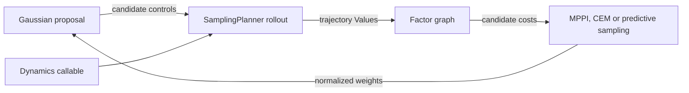

# Sampling-based planning with factor-graph costs

By Akash Ratheesh and Frank Dellaert

A sampling planner chooses a sequence of controls by predicting what each candidate
would do and scoring the resulting trajectory. In GTSAM the dynamics describe
how the state evolves, and a `NonlinearFactorGraph` describes what makes a
trajectory desirable. A terminal pose prior can express a goal, a control prior
can penalize effort, and a factor joining distant states can score net displacement.

## How a solve fits together



The planner owns the horizon, rollout, and graph evaluation. The proposal owns
the sampling distribution and knows how to adjust its nominal control sequence.
The MPPI rule needs only the cost of each candidate to decide its relative
weight. This division lets the same optimization code plan for a point mass
or a robot on a manifold, and lets the caller change an objective by editing factors.

| C++ API | Role |
| --- | --- |
| `SamplingPlanner<State, Control>(stateKeys, controlKeys, dt)` | Associates the trajectory with its ordered graph keys and sets the integration step for a vector field. |
| `GaussianProposal(covariance, numSamples, seed)` | Uses `GaussianNoiseSampler` to perturb the current control sequence and updates it with a weighted mean. |
| `MPPI(inverseTemperature)` | Converts the graph costs into normalized weights and passes them back to the proposal. |
| `CEM(elites, minStddev)` | Fits the Gaussian to the lowest-cost candidates. |
| `PredictiveSampling()` | Selects the lowest-cost candidate, including the incumbent. |
| `planner.rollout(initial, controls, dynamics)` | Predicts the trajectory for a single control sequence and returns its `Values`. |
| `planner.optimize(graph, initial, dynamics, proposal, rule, iterations)` | Initializes the search, repeats the sampling update, and returns the final nominal trajectory. |
| `planner.iterate(graph, initial, dynamics, proposal, rule, search)` | Advances a caller-owned search by one iteration. Initialize it with `proposal.initialize(planner.nominalControls(initial))`. |

The C++ declarations give the callable signatures and the layout of a sampled
batch. [SamplingPlanner](https://github.com/borglab/gtsam/blob/develop/gtsam/planning/SamplingPlanner.h), [GaussianProposal](https://github.com/borglab/gtsam/blob/develop/gtsam/planning/ControlProposals.h),
and [MPPI](https://github.com/borglab/gtsam/blob/develop/gtsam/planning/SamplingAlgorithms.h).

## Choosing the dynamics

**A vector field returns velocity in the tangent coordinates of the current
state.** For a time step $\Delta t$, the planner computes
$x_{k+1}=\operatorname{Retract}_{x_k}(\Delta t\,f(x_k,u_k))$.
A planar point mass has state $(p_x,p_y,v_x,v_y)$ and acceleration control
$(a_x,a_y)$. Its tangent velocity is $(v_x,v_y,a_x,a_y)$, so this Euler step
is exactly the point-mass example's discrete prediction.

```cpp
auto dynamics = [](const Vector4& x, const Vector2& u) {
  return Vector4{x(2), x(3), u(0), u(1)};
};
```

**A discrete transition returns the next state itself.** Wrap it in
`discreteTransition` when the model already defines a complete step.
This distinction matters even in Euclidean space, where a state and its
velocity can have the same C++ type. The unicycle below moves forward in its
current body frame and then turns. Its step includes the time interval.

```cpp
auto transition = discreteTransition([dt](const Pose2& x, const Vector2& u) {
  return x.compose(Pose2(dt * u(0), 0.0, dt * u(1)));
});
```

The planner uses the same dynamics callable at every step of the horizon. Each horizon step writes
its control and predicted successor into `Values`. The graph can therefore
read any state or control in the horizon as well as auxiliary variables
supplied by the caller. In TBB builds, independent rollouts may call native
dynamics concurrently. A discrete transition with thread affinity can request
`discreteTransition(step, false)`. Factors are scored on the calling thread by
default. Enabling `parallelCandidateScoring` permits concurrent scoring when
every factor in the graph is sendable.

## Building and solving a problem

A horizon with $H$ controls needs $H+1$ state keys. The initial values provide
the measured state and one nominal control per step. This example gives a point
mass two seconds to reach a terminal position and velocity while penalizing
acceleration. It uses the vector field defined above.

```cpp
using symbol_shorthand::U;
using symbol_shorthand::X;
const size_t H = 20;
const double dt = 0.1;
const Vector4 start{0.0, 0.0, 0.0, 0.0}, goal{1.0, 0.0, 0.0, 0.0};
const Vector2 zero{0.0, 0.0};
KeyVector states{X(0)}, controls;
NonlinearFactorGraph graph;
Values initial;
initial.insert(X(0), start);
for (size_t k = 0; k < H; ++k) {
  states.push_back(X(k + 1));
  controls.push_back(U(k));
  initial.insert(U(k), zero);
  graph.addPrior(U(k), zero, noiseModel::Isotropic::Sigma(2, 2.0));
}
graph.addPrior(X(H), goal, noiseModel::Isotropic::Sigma(4, 0.1));

SamplingPlanner<Vector4, Vector2> planner(states, controls, dt);
GaussianProposal proposal(0.25 * Matrix2::Identity(), 1024, 42);
const MPPI rule(1.0);
Values plan = planner.optimize(graph, initial, dynamics, proposal, rule, 30);
double cost = graph.error(plan);
```

## One MPPI update

The proposal draws $K$ complete control sequences $V_i$ by adding zero-mean
Gaussian perturbations to the nominal sequence $\bar U$. Each column of
$\bar U$ is one control. The covariance specifies the relationship among
control coordinates within a step. The planner rolls out each sequence from
the same measured state and assigns it a cost $J_i$ equal to the graph error
on that trajectory.

Given inverse temperature $\beta$, the MPPI rule assigns weights, and the
Gaussian proposal uses them to update its mean:

$$
w_i = \frac{\exp[-\beta(J_i-\min_j J_j)]}
           {\sum_\ell \exp[-\beta(J_\ell-\min_j J_j)]},
\qquad \bar U_{\mathrm{new}} = \sum_i w_i V_i .
$$

Subtracting the minimum preserves the weights and stabilizes the exponential.
A larger inverse temperature gives lower-cost trajectories more influence.
Control-effort factors enter $J_i$ directly. This corresponds to the
$\alpha=1$ formulation of MPPI with a Gaussian centered on the nominal plan.
[Williams et al., IEEE Transactions on Robotics](https://doi.org/10.1109/TRO.2018.2865891)

## From one plan to receding-horizon control

Trajectory optimization uses the entire plan returned by one solve. A
receding-horizon controller executes its first control, measures the next
state, shifts the remaining controls forward by one step, and calls the same
planner again. Keeping the proposal across solves advances its random stream.

The examples illustrate both open-loop optimization and receding-horizon
control. [C++ examples](../../../gtsam_unstable/examples/mppi/README.md)

## Python user guides

The Python and MATLAB planners use dynamic vectors for controls.
`SamplingPlannerVectorVector` also uses a vector for the state, so the same
class handles a scalar system and a four-coordinate point mass. Use
`SamplingPlannerPose2Vector` for a planar pose. Its vector field returns a
three-coordinate tangent vector, and its discrete transition returns a `Pose2`.

[Planning a trajectory with a factor graph](SamplingPlanner.ipynb) builds a graph and
uses both forms of dynamics. [Gaussian proposals and the MPPI update](MPPI.ipynb)
follows a Gaussian proposal through one update and visualizes how each sampled
trajectory contributes to the next plan.

## Changing the update rule

The planner evaluates every sampled trajectory with the same factor graph.
MPPI averages the sampled controls using exponential cost weights. Predictive
sampling includes the incumbent and selects the lowest-cost trajectory, so its
nominal cost can only decrease or stay constant for a deterministic rollout.
CEM gives equal weight to the lowest-cost finite elites and refits both the
mean and marginal standard deviation at each control and time step. The
standard-deviation floor keeps the search exploring when the elites agree.

Pass `CEM(elites, minStddev)` or `PredictiveSampling()` in the same argument
position as `MPPI(inverseTemperature)`. The explicit Gaussian proposal owns
the random streams. The search state holds the fitted controls and dispersion.
See the [sampling search guide](SamplingSearch.ipynb) for a complete solve.
